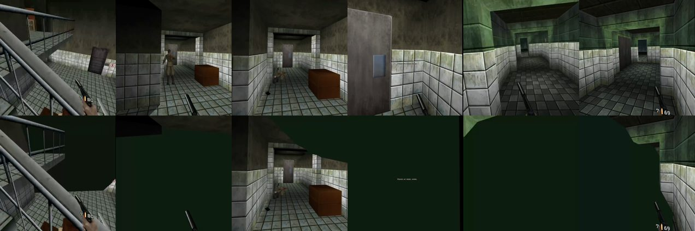

# Facility: green flashes (2026-10-17)

Report: on XBLA (Bean) Facility, walls and floors flicker green. It happens
with AI fill on or off and with SpaceWarp on or off. Evidence: the player's 43 s
video, then headset recordings (`adb shell screenrecord`, both eyes at about
60 fps) on Quest 3 2G0YC1ZF8Q0JQ6.

## What it is

A flash frame is flat RGB (12, 28, 15): Facility's fog colour
0x10, 0x20, 0x10 (`bgfog.c`, and Bean's fog table `0x102010`). Only the
stats overlay, the vignette and the HUD quad survive on it. It is not z-fighting
and not missing room geometry. The eye image reached the compositor holding only
the display list's first draw, the background fill.

**Cause: the 2x multisampled eye image drawn directly.** The eye framebuffer
uses multisampled render-to-texture (`FramebufferTextureMultisampleMultiviewOVR`,
`EyeMsaa=2` by default since v0.5.6; 4x since v0.5.4). A frame whose display
list is drawn straight into it (`gfx_run`'s non-deferred branch) switches
targets for its HUD captures in the middle of the pass. That image came out
holding only its first fill. Recorded frames replayed in one pass
(`gevr_vr_replay_frame`) came out whole.

Measurements: flashes per ~14 s, standing still in the vent at level start.

| Build / switch | Flashes |
| --- | --- |
| v0.5.6, `gevr_pipeline.txt` 1 (every fresh frame drawn directly) | 349-379 (half the frames) |
| replay skips mesh draws / ring draws / reprojection | still flashes on the other half |
| no presentation correction; skip mesh draws in the direct pass | 365-366 |
| `glFinish` before releasing the eye image | 339 |
| detach the eye texture before release | 357 |
| read back one pixel of the eye texture before release | 0 |
| eye MSAA forced to 1 | 0, all frames whole |
| **fix**, pipeline 1 / default / default + SpaceWarp off | **0 / 0 / 0** |

At the default pipeline (2), the early tick normally defers the eye pass and
the replay draws it, which avoids the bug. Frames without an early tick are
drawn directly: the intro's stereo part (intro mode 3 until gameplay; the
player's "intro covering the screen") and frames that miss the early tick. In
the player's log, the green screenshot at 18:48:42 fell in a second with one
such frame. Before the fix, the intro window recorded on the headset had 1 flash.
After the fix it had 0.

## Fix

`gfx_pc.cpp gfx_run`: when the eye image is multisampled
(`vr_eye_multisampled()`, `vr_openxr.cpp`), a frame that was not deferred also
takes the record-then-replay branch. The replay draws the whole image in one
pass; the scopes render after it, as for deferred frames. Pose relocation stays
on deferred frames only. Single-sampled eyes keep the old branches, so pipeline
0/1 stay comparable for profiling.

Tested on the headset, driven over adb: pipeline 1, the default, and the default
with SpaceWarp off. At a CPU level of 0 with turning and walking, 127 frames
missed the early tick, and none flashed full-screen.

## Edge wedges: fixed in v0.5.10

Rarer, smaller fog-colour (or black) wedges over the close-up floor for one
frame. They were not chunk culling (PR #207's theory, closed): a probe never
found a visible chunk dropped at record time.

They were guards' detailed guns (`gevr_heldgun.c`, first-person G models such
as Gak47Z) drawn under matrices still in floats. A held gun is posed into a
float `Mtxf` and converted to fixed point only in the guard's alpha pass
(`chr.c`). Every guard whose draw list was rebuilt took one of the 48 LRU
slots, and Facility rebuilds more than 48, so a guard could lose its slot
between its opaque draw and its alpha pass. Its recorded draw then read float
bits as s15.16 (entries near +-16000, `[3][3]` 0): triangles thousands of
units across the eye, about 17 runs a frame, crossing the view now and then.
Only a pose (`gevrHeldGunCompute`) takes a slot now, and an evicted slot's
pending pose is converted first. 10 minutes of driven Facility: 0 broken
frames, about 18 before.

How it was found: an eye probe (thumbnails of our own eye image, a frame
unlike both neighbours), a twin render (the same kept draws never drew
differently, so it was deterministic), kept draws of confirmed frames redrawn
inside RenderDoc in-app captures, RenderDoc for Meta Quest's Python API to
bisect the frame to the painting draw, then logs naming the model and its
caller. The probes are kept outside the repo (build/dev-scripts).

## Re-testing

`files/gevr_pipeline.txt` 1 makes every fresh frame direct, the fastest repro
on an old build (no head motion needed). `adb shell screenrecord` captures both
eyes; count frames whose colour is mostly 0x102010.
