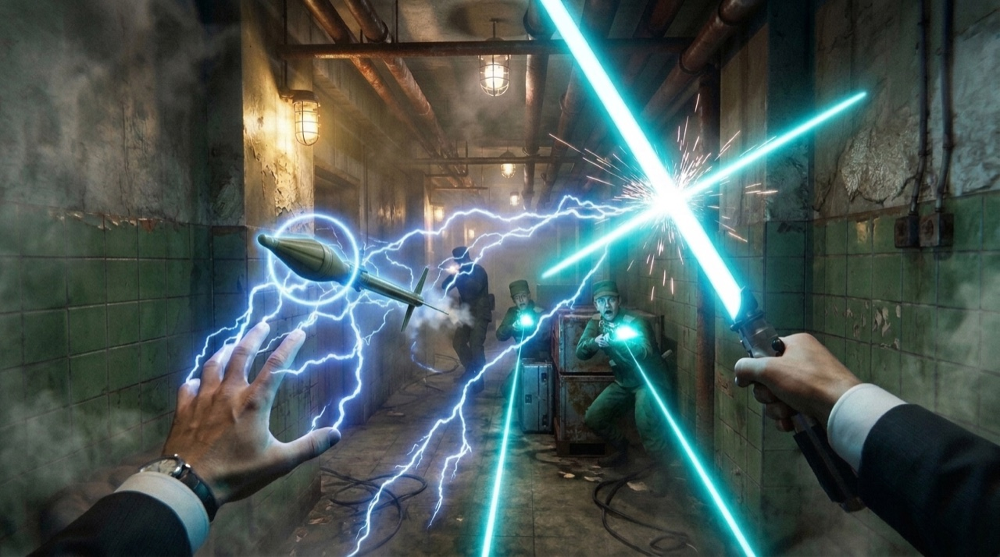

  

<h1 align="center">Jedi &amp; Ninja Modes</h1>

  <b>Lightsabers, Force telekinesis, DL-44 blasters, katanas, and bouncing throwing blades inside GoldenEye 007.</b> 
  Two mutually exclusive playstyles built to run everywhere GoldenEye VR does: Quest, PCVR, flat-screen PC, iOS, tvOS, visionOS, Android, and dedicated server.

  <a href="#jedi-mode">Jedi Mode</a> ·
  <a href="#blasters--the-dl-44">Blasters &amp; DL-44</a> ·
  <a href="#ninja-mode">Ninja Mode</a> ·
  <a href="#controls--wheel">Controls &amp; Wheel</a> ·
  <a href="#menus--configuration">Menus &amp; Options</a>

---

Both modes stay **off by default** so standard missions load untouched. Flip either one on from the Launcher or Pause menu and GoldenEye turns into a deflecting, dismembering, physics-driven corridor brawler (ragdolls, dismemberment, and 24-second body retention switch on automatically). Enable Jedi and Ninja turns off; enable Ninja and Jedi turns off.

## Jedi Mode

  

Walk into Facility with an igniting plasma blade in one hand and the Force in the other.

- **Three Saber Styles & Eight Colors:** Run a **Single** blade, a spinning **Double-Bladed** staff (dual emitters on the hilt, twin-disc saber throw), or **Dual Sabers** (full off-hand tracking in VR). Pick from `Blue`, `Green`, `Red`, `Purple`, `Yellow`, `White`, `Orange`, or `Gold`.
- **Aimed Deflection & Perfect Parry:** Hold block to turn aside incoming shots, or catch gunfire right inside the first **0.22s** parry window (`Perfect parry`) for a bright crit-boosted counterbolt (38 damage vs 16) that snaps toward where your headset/gaze is looking in VR — or locks blades in a sparks-flying **Sith Saber Lock** if a Sith swings at the same time.
- **Force Powers on the Off-Hand:**
  - **Force Grab / Choke (`FORCE TK`):** Lock onto a guard (or suspended ragdoll corpse/severed limb) and hoist them into the air. Twist or whip your wrist sideways in VR to slam them across the room or into other guards, or snap downward below waist speed to trigger a radial **Force Slam**.
  - **Force Push & Pull:** Flick forward or tap/release cleanly to blast nearby guards back as live ragdolls — or use Pull/Push (`Catch rockets`) to snag flying RPGs and grenades mid-air and hurl them straight back downrange.
  - **Force Lightning (`LIGHTNING`):** Chain jagged high-voltage arcs to up to **3** nearby guards simultaneously, stunning and frying entire rooms while your saber stays ready in the main hand.
  - **Saber Throw (`THROW`):** Whip the saber hand forward in VR (or double-tap attack/trigger on flat) and guide the spinning plasma blade straight through a hallway of guards before recalling it to your palm.
- **Custom Stereo Synth Audio & Blade Trails:** A dedicated 22,050 Hz stereo DSP mixer generates dual-detuned lightsaber hum, Doppler swing whooshes, ignition snap-hiss, deflections, metallic clashes, Force sub-bass drones, lightning crackle, and blade spin overhead — paired with 7-sample motion ribbons and plasma wall-scorch sparks when dragging a hot tip across concrete.
- **Sith Enemies & Jedi Ally:** Spawn red-saber Sith NPCs (off by default, `Random` or `Frequent`, about a third wielding double-bladed staffs) at Normal, Giant, Tiny, or random heights — even inside standard GoldenEye missions via `Sith in normal`. Flip on **Jedi ally** to arm your AI wingman with a saber and Force powers too.

## Blasters & the DL-44

  

Deflecting invisible hitscan bullets is mostly guesswork. Turning **Blasters** on (`On` by default whenever Jedi mode is active) fixes that:

- **NPCs & Turrets Fire Laser Bolts:** Enemy guards (including shotguns and rifles) and ceiling/drone autoguns fire GoldenEye's native glowing `ITEM_LASER` energy bolts from the muzzle across the full room trajectory with laser audio — making incoming fire clean to read, dodge, or bat back at whoever pulled the trigger. Rocket and grenade launchers remain rockets and grenades so **Catch rockets** still shines.
- **Default DL-44 Heavy Blaster on Spawn:** Every Jedi mission with Blasters on starts with the `ITEM_LASER` sidearm unlocked and equipped in your right hand, waiting on the 4th Jedi wheel slot (`BLASTER`). When drawn, GoldenEye's Moonraker mesh swaps out for a custom-sculpted 3D **DL-44 Heavy Blaster Pistol** — walnut Mauser C96 broomhandle grip, lanyard cap, gunmetal receiver with exposed hammer and brass side greeble, ribbed barrel cooling fins, flared slotted MG42 flash hider with recoil kick & muzzle flash, and a right-offset Hensoldt sniper scope (`Left-handed` flips the offset cleanly) firing GoldenEye's real laser bolts.
- **Smart Pickup Rules (`Pick up guns` off by default):** In both Jedi and Ninja modes, dropped enemy firearms, knives, launchers, grenades, mines, and ammo boxes are ignored by default so your inventory stays pure — whether walking over drops, grabbing with a VR hand, or Force-Pulling objects across the room. **Keycards, keys, body armour, watch lasers, mission gadgets (decoders, cameras, bugs, plastiques, blackboxes, tapes), and Egypt's mission Golden Gun** still pick up without interruption. Flip **Pick up guns** on anytime if you want every dropped gun back.

## Ninja Mode

  

No Force crutches — just steel, momentum, smoke, and timing.

- **Six Sword Loadouts:** Choose between **Katana**, **Gold Katana**, faster close-quarters **Short** / **Gold Short** wakizashi, or **Dual Short** / **Dual Gold** for two-handed slashing in VR and flat screen, leaving sweeping steel motion ribbons and directional ragdoll cuts on lethal strikes.
- **Corridor-Ricocheting Boomerangs:** Pick **Shuriken**, **Wing**, **Gold Shuriken**, or **Gold Wing**, whip your throwing hand (or switch to `BOOMERANG` on the wheel / double-tap attack) and bank spinning blades around hallway corners using up to **2** shallow-angle wall bounces before they curve back into your hand.
- **Buckler Shield & Bullet-Slice:** Select `SHIELD` on the wheel (`Ninja shield`) to block and deflect incoming rounds off an off-hand black-and-gold octagonal shield — or go full aggression with **Bullet slice**, severing incoming bullets mid-swing whenever your blade cuts across the shot.
- **Shadow-Step Dash:** Trigger the `SHADOW` slot on the wheel or double-tap your off-hand button (`LT` / right-click) for a burst of grey tactical smoke clouds and a rapid speed surge to close distance or vanish around a corner (`Shadow-Step`).
- **Evil Ninjas:** Populate maps with sword-and-boomerang Ninja adversaries (and optionally spawn them in normal missions via `Ninjas in normal`).

## Controls & Quick Wheel

| Action | Stereo VR (Tracked Hands) | Gamepad / Mouse & Keyboard / Touch |
|---|---|---|
| **Slash / Heavy Swing** | Swing primary (or dual off-hand) controller past speed threshold | Tap `RT` / Left Click / Touch Fire |
| **Block / Deflect / Shield** | Hold primary trigger (`RT`) or off-hand trigger for Ninja Shield | Hold `RT` / Left Click (`Parry` inside first `0.22s`) |
| **Throw Saber / Boomerang** | Whip weapon hand forward and release trigger (or use wheel slot) | Double-tap `RT` / Left Click |
| **Force Power / Shadow-Step** | Hold off-hand trigger (`LT`), pull wrist toward chest for Pull/Choke, snap down for Slam | Hold or tap `LT` / Right Click (double-tap `LT` for `Shadow-Step`) |
| **Mode Wheel** | Press `X` / left thumbstick click (or controller wheel binding) | Hold `LB` / `Q` / Touch wheel |

**Wheel Layouts**
- **Jedi Wheel (4 slots):** `FORCE TK` · `LIGHTNING` · `THROW` · `BLASTER` *(shows `GUNS` when `Blasters` is off)*
- **Ninja Wheel (6 slots):** `KATANA` · `SHORT` · `DUAL` · `SHIELD` · `BOOMERANG` · `SHADOW`

## Menus & Configuration

Jedi and Ninja never run together — flipping one **On** automatically sets the other **Off**. Everything fits in two dedicated menus without cluttering existing tabs:

- **Launcher:** **Rules** -> **Jedi** / **Ninja** tabs *(beside `Game rules`, `AI ally`, `Cheats`)*
- **In-Game Pause Panel:** **Mods and fun** -> **General** | **Jedi** | **Ninja** sub-tabs

<b>All Jedi Mode Options (15 settings, saved to goldeneye-vr.ini)</b>

| Menu Row | Values | Default | `goldeneye-vr.ini` Key |
|---|---|---|---|
| **Jedi mode** | Off / On *(turns Ninja mode Off, auto-enables Ragdolls + Dismemberment + 24s Body stay)* | Off | `JediNinjaMode` (`0`/`1`) |
| **Saber style** | `Single`, `Double-Bladed`, `Dual Sabers` | `Single` | `SaberStyle` |
| **Saber colour** | `Blue`, `Green`, `Red`, `Purple`, `Yellow`, `White`, `Orange`, `Gold` | `Blue` | `SaberColor` |
| **Saber hand** | `Right`, `Left` | `Right` | `JediHand` |
| **Force powers** | Off / On *(Force Grab/Choke, Pull, Push, Lightning, Slam)* | On | `JediForcePowers` |
| **Catch rockets** | Off / On *(Pull/Push catches & reflects live rockets and grenades)* | On | `JediCatchProjectiles` |
| **Perfect parry** | Off / On *(0.22s timed reflect crits & Sith Saber Locks)* | On | `JnPerfectParry` |
| **Blade trails** | Off / On *(7-sample blade ribbons & wall-scorch sparks)* | On | `JnBladeTrails` |
| **Custom SFX** | Off / On *(22,050 Hz synth hum, Doppler swings, clashes, Force bass)* | On | `JnAudio` |
| **Blasters** | Off / On *(NPC/turret `ITEM_LASER` bolts + default DL-44 sidearm)* | On | `JediBlasters` |
| **Pick up guns** | Off / On *(Allow picking up combat guns/ammo; keys & gadgets stay enabled)* | Off | `JediPickupGuns` |
| **Sith NPCs** | `Off`, `Random` (1), `Frequent` (3) | `Off` | `SithNpc` |
| **Sith size** *(when Sith NPCs on)* | `Normal`, `Random`, `Giant`, `Tiny` | `Normal` | `SithScale` |
| **Sith in normal** *(when Sith NPCs on)* | Off / On *(Allow Sith spawns in normal Bond mode)* | Off | `SithInNormalMode` |
| **Jedi ally** *(when AI Ally enabled)* | Off / On *(Arm your AI ally with a lightsaber & Force powers)* | Off | `AllyJedi` |

<b>All Ninja Mode Options (10 settings, saved to goldeneye-vr.ini)</b>

| Menu Row | Values | Default | `goldeneye-vr.ini` Key |
|---|---|---|---|
| **Ninja mode** | Off / On *(turns Jedi mode Off, auto-enables Ragdolls + Dismemberment + 24s Body stay)* | Off | `JediNinjaMode` (`0`/`2`) |
| **Ninja sword** | `Katana`, `Gold Katana`, `Short`, `Gold Short`, `Dual Short`, `Dual Gold` | `Katana` | `NinjaSword` |
| **Boomerang** | `Shuriken`, `Wing`, `Gold Shuriken`, `Gold Wing` | `Shuriken` | `NinjaBoomerang` |
| **Ninja shield** | Off / On *(Off-hand buckler bullet deflection)* | On | `NinjaShield` |
| **Wall ricochet** | Off / On *(Shallow-angle corridor boomerang bounces)* | On | `NinjaRicochet` |
| **Shadow-Step** | Off / On *(Smoke clouds & speed dash via `SHADOW` slot or double-tap `LT`)* | On | `NinjaShadowStep` |
| **Bullet slice** | Off / On *(Cut incoming bullets out of the air mid-swing)* | On | `NinjaBulletSlice` |
| **Pick up guns** | Off / On *(Allow picking up combat guns/ammo; keys & gadgets stay enabled)* | Off | `NinjaPickupGuns` |
| **Evil Ninjas** | `Off`, `Random` (1), `Frequent` (3) | `Off` | `NinjaNpc` |
| **Ninjas in normal** *(when Evil Ninjas on)* | Off / On *(Allow Evil Ninja spawns in normal Bond mode)* | Off | `NinjaInNormalMode` |

